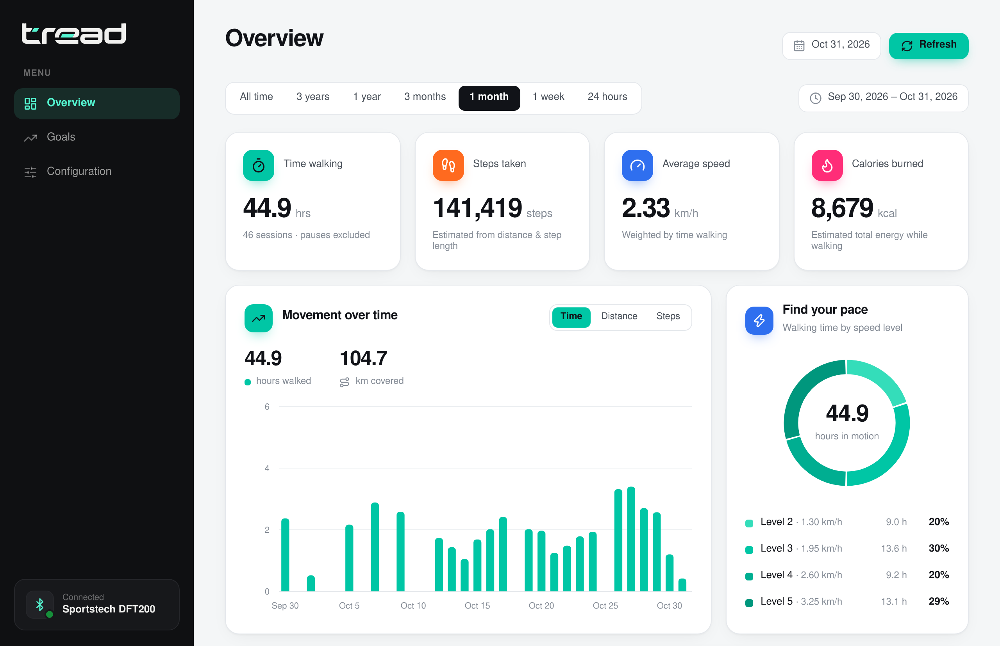
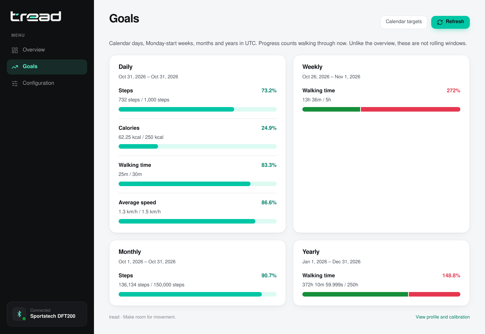

# tread

A small Go CLI for an underdesk treadmill, with a SQLite usage log and a dashboard. Currently supporting DFT200.

> [!NOTE]
> This is completed vibe-coded. Use at your own risk.



## Try the dashboard

> [!WARNING]
> The server has no authentication and is meant for local use. Don't expose it to the internet.

```sh
go run ./cmd/tread serve -demo
```

Open <http://127.0.0.1:18743>. Demo mode uses generated history in an in-memory database; it never touches Bluetooth or your real data.

## Supported devices

| Device            | `treadmill.driver` | Controls                                  | Speed levels | Live telemetry                                          |
| ----------------- | ------------------ | ----------------------------------------- | ------------ | ------------------------------------------------------- |
| Sportstech DFT200 | `dft200`           | start, pause, resume, stop, speed, status | 1–8          | Experimental: speed, distance ([Telemetry](#telemetry)) |

Devices connect over Bluetooth LE through BlueZ. To add a device, implement `device.Driver` in a new `internal/drivers/` subpackage and add it to the registry in `internal/drivers/drivers.go`. Speed levels other than 1–8 aren't supported yet.

## Setup

Requires Go (see `go.mod`), Linux and BlueZ.

```sh
go build -o tread ./cmd/tread
mkdir -p ~/.local/bin ~/.config/tread
ln -s "$(pwd)/tread" ~/.local/bin/tread
cp config.example.toml ~/.config/tread/config.toml
```

Edit the config: set `treadmill.mac` (find it with `bluetoothctl`, `scan on`, `devices`), your personal measurements and calibrated speeds. Use `-config <path>` or `TREAD_CONFIG` for another config file, `TREAD_DB_PATH` to override `db_path` for the SQLite database, and `TREAD_STATE_DIR` for the usage queue and control state (default: `~/.local/state/tread`). Keep the state directory persistent; it can hold usage not yet delivered. `tread config` prints the effective configuration.

Then run these two long-lived processes:

```sh
tread agent   # owns the Bluetooth connection
tread serve   # dashboard and API
```

## Commands


> [!CAUTION]
> A speed command can start a stopped belt. Only send movement commands with the belt clear.

Commands go through the agent and are sent at most once. "No command sent" is safe to repeat; "Command outcome unknown; do not retry" means check the treadmill first. `tread -direct <command>` bypasses the agent with a short-lived connection (fails while the agent runs).

```sh
tread start | resume | pause | stop
tread speed <1-8>          # speed level, not km/h
tread toggle               # pause if running, otherwise start
tread speed-up | speed-down
tread status
tread observed [-json]     # live telemetry snapshot from the agent
tread sync                 # retry queued usage delivery
tread stats -period 1m     # or -period all -json, -days N
tread help
```

### Local state

tread tracks mode and speed from the commands it sends, not from telemetry. `speed-up`/`speed-down` only work once running mode and speed are known: start the belt, then use `speed <n>` or `speed-down` to establish speed.

After a power cycle, remote-control use or suspend, run `tread reset-state` to forget local knowledge. Don't delete the files in the state directory; they may hold usage awaiting delivery.

### Telemetry

Set `experimental_van_telemetry = true` to decode live readings (speed, distance) shown in `observed` and the dashboard. Reported values are the treadmill's nominal speed, not your calibrated speed. With telemetry on, `idle_disconnect_timeout` disconnects after a period of paused, zero-speed state; the next command reconnects.

### Remote server

Run `serve` on another host and point the controller's `server_url` at it. Keep personal settings and calibration in the server's config. The API has no authentication, so use a private network or authenticated reverse proxy.

### Optional hostname

```sh
sudo "$(command -v tread)" setup-host -name tread.localhost
```

Adds a `/etc/hosts` entry for <http://tread.localhost:18743>.

## Statistics

Measure each speed level and fill `[treadmill.speed_kmh]`, then set `calibrated = true`:

```text
km/h = belt length (m) × revolutions ÷ seconds × 3.6
```

- Walking time excludes pauses (expire after 270 s); a stretch without commands is capped at two hours.
- Distance integrates calibrated speed; steps use `step_length_m` (fallback: height × 0.414).
- Calories use [Compendium MET values](https://pacompendium.com/walking/) and, given full personal data, [Mifflin-St Jeor](https://pubmed.ncbi.nlm.nih.gov/2305711/). They are estimates.
- History is recalculated from the current config. Missing data shows as a dash.

Config is reloaded per request; restart the server after changing `db_path` or `listen`.

## Goals

```sh
cp goals.example.yaml ~/.config/tread/goals.yaml
```

```yaml
daily:
  steps: 1000
  calories: 250
  time: 30m
  average_speed_kmh: 1.5
weekly:
  time: 5h
monthly:
  steps: 150000
yearly:
  time: 250h
```

All entries are optional. Periods are calendar-based (Monday-start weeks) in the configured timezone. The file is reloaded on each request.



## Structure

```text
cmd/tread/          CLI, commands, server startup
internal/agent/     Bluetooth owner process and local socket API
internal/ownership/ Runtime directory and single-owner lock
internal/observed/  Live readings model
internal/ble/       Bluetooth transport
internal/device/    Driver contract: commands, capabilities, telemetry
internal/drivers/   Driver registry, one subpackage per device (dft200/)
internal/config/    TOML settings
internal/event/     Control events and offline delivery
internal/control/   Local mode/speed knowledge
internal/store/     SQLite storage
internal/stats/     Sessions, calibration and estimates
internal/goals/     YAML targets and progress
internal/server/    HTTP API and embedded files
internal/demo/      Mock history
web/                Plain HTML/CSS/JS dashboard
```

## Development

```sh
go test ./...
go vet ./...
```

The images in `docs/images` come from `scripts/demo`, which runs the agent on a fake Bluetooth backend with generated history:

```sh
(cd scripts && npm install && npm run screenshots)  # needs Chrome or Chromium
vhs scripts/cli.tape                                # needs VHS
```

## License

Licensed under [Apache 2.0](LICENSE). Includes [Lucide](https://lucide.dev) icons; their ISC/MIT license notices are embedded in [`web/icons.svg`](web/icons.svg).
